<div align="center">

<!-- Minimalist Engineering Banner with 3D Rotating Cube & Shimmer Beam -->
[](https://github.com/hoangphan636)

<br/>

<!-- Clean Typing Tagline -->
[;Deterministic+CI%2FCD+Quality+Gates+%26+Matrix+Sharding)](https://git.io/typing-svg)

</div>

---

### 👨‍💻 About Me

<table>
  <tr>
    <td width="58%" valign="top">

```typescript
interface StaffQualityArchitect {
  name: "Hoang Phan";
  role: "Senior QA Automation Engineer • Principal Test Architect";
  location: "Ho Chi Minh City, Vietnam 🇻🇳";
  specialties: [
    "Enterprise E2E Test Automation (Playwright, Appium)",
    "High-Concurrency Performance Engineering (k6, JMeter)",
    "AI-Assisted Test Automation & Self-Healing Locators",
    "Deterministic CI/CD Pipelines & Quality Gates"
  ];
  currentFocus: [
    "Model Context Protocol (MCP) Test Servers",
    "Cross-Platform Native & Mobile Test Infrastructure"
  ];
  availability: "Available for Senior / Lead / Principal QA roles";
}
```

> *"Program testing can be used to show the presence of bugs, but never to show their absence!"*  
> — **Edsger W. Dijkstra**

</td>
<td width="42%" align="center" valign="middle">


</td>
</tr>
</table>

---

### 🌐 Connect With Me

<p align="center">
  <a href="https://linkedin.com/in/"></a>
  &nbsp;
  <a href="https://github.com/hoangphan636"></a>
  &nbsp;
  <a href="mailto:hoangphannhat10@gmail.com"></a>
  &nbsp;
  <a href="https://t.me/"></a>
</p>

---

### 🛠 Technical Competencies

<table>
  <tr>
    <td width="24%"><b>E2E &amp; Mobile QA</b></td>
    <td>Playwright • Appium 2.x • Cypress • Selenium • UIAutomator2 • XCUITest</td>
  </tr>
  <tr>
    <td width="24%"><b>Languages &amp; Runtimes</b></td>
    <td>TypeScript • JavaScript (Node.js) • Java (JUnit 5, TestNG) • Python</td>
  </tr>
  <tr>
    <td width="24%"><b>BDD &amp; API Testing</b></td>
    <td>Cucumber (Gherkin) • REST Assured • Postman • OpenAPI / Swagger</td>
  </tr>
  <tr>
    <td width="24%"><b>Performance &amp; Observability</b></td>
    <td>k6 Load Testing • Artillery • Apache JMeter • Grafana • InfluxDB</td>
  </tr>
  <tr>
    <td width="24%"><b>CI/CD &amp; Infrastructure</b></td>
    <td>GitHub Actions • GitLab CI • Azure DevOps • Docker • Linux (Bash)</td>
  </tr>
  <tr>
    <td width="24%"><b>AI &amp; Web3 Quality</b></td>
    <td>Autonomous QA Agents • Self-Healing Locators • Hardhat • Ethers.js</td>
  </tr>
</table>

<br/>

<div align="center">
  
</div>

---

### ⚡ 3D Automated Test Architecture &amp; Execution Pipeline
*Interactive visualization of multi-shard execution, MCP agent routing, and deterministic quality gates.*

<div align="center">

[](https://github.com/hoangphan636)

</div>

---

### 📦 Featured Engineering Repositories
*Core open-source architectures, test automation frameworks, and MCP tooling.*

<table>
  <tr>
    <td width="33.3%" valign="top">
      <a href="https://github.com/hoangphan636/playwright-agent-mcp">
        
      </a>
    </td>
    <td width="33.3%" valign="top">
      <a href="https://github.com/hoangphan636/Extension-QA">
        
      </a>
    </td>
    <td width="33.3%" valign="top">
      <a href="https://github.com/hoangphan636/Mobile-mcp">
        
      </a>
    </td>
  </tr>
</table>

---

### 🔄 Recently Updated Repositories
*Latest active commits, codebases, and tool integrations.*

<table>
  <tr>
    <td width="33.3%" valign="top">
      <a href="https://github.com/hoangphan636/Rule-Agent">
        
      </a>
    </td>
    <td width="33.3%" valign="top">
      <a href="https://github.com/hoangphan636/playwright-agent-mcp">
        
      </a>
    </td>
    <td width="33.3%" valign="top">
      <a href="https://github.com/hoangphan636/Format-CV">
        
      </a>
    </td>
  </tr>
</table>

---

### 📈 GitHub Analytics

<div align="center">

<!-- Streak Stats -->


<br/><br/>

<!-- Stats & Top Languages -->

&nbsp;


<br/><br/>

<!-- Dev Quote -->


</div>

---

### 💎 10 3D &amp; Animation Architectural Systems

<details>
<summary><b>Click to inspect 3D &amp; Animation Engineering Specifications</b></summary>
<br/>

1. **3D Floating Isometric Quality Cube**: Rotating wireframe cube in hero banner with orthographic perspective depth.
2. **Dynamic Orbital Particle Ring**: Continuous orbital path tracing around the quality core at 60fps.
3. **Linear-Style Border Shimmer**: Micro-animation light beam sweeping across top card borders with subtle specular reflection.
4. **Live Radar Pulse Tickers**: Concentric breathing rings marking real-time active components and languages.
5. **Multi-Stage 3D Sharded Execution Pipeline**: Isometric flow showing parallel test shards executing simultaneously.
6. **Animated Data Flow Stream**: SVG stroke-dashoffset streams transferring execution packets across stages.
7. **MCP Agent Node Constellation**: Interconnected orbital node network symbolizing Model Context Protocol routing.
8. **Staggered Card Floating Physics**: Smooth vertical micro-animations creating organic elevation across components.
9. **Zero-Flicker CSS Keyframes**: Fully hardware-accelerated animations running natively inside lightweight SVG vectors.
10. **3D Rendered Engineering Lab Artwork**: High-definition side-by-side terminal + 3D workstation visual with subtle border styling.

</details>

---

### ⚙️ Repository Synchronization Utility

```powershell
# Query repository state & verify recent updates via GitHub CLI
.\scripts\update_repos.ps1
```
