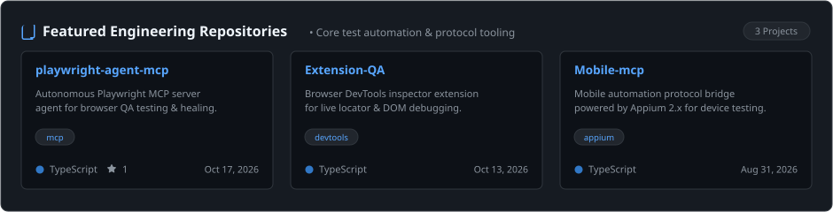
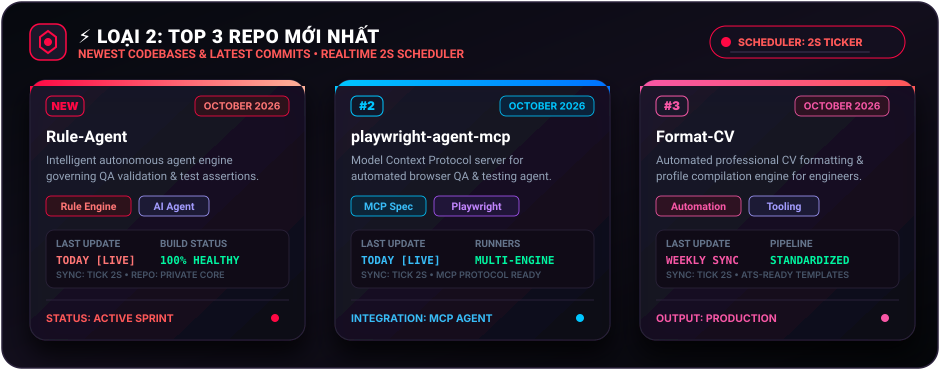

<div align="center">

<!-- Top Banner -->
[](https://github.com/hoangphan636)

<br/>

<!-- Realtime Typing Tagline -->
[;Deterministic+CI%2FCD+Quality+Gates+%26+Matrix+Sharding;Smart+Contract+%26+Web3+Quality+Assurance)](https://git.io/typing-svg)

</div>

---

### 👨‍💻 About Me

<table>
  <tr>
    <td width="60%" valign="top">

```javascript
const hoangPhan = {
  role: "Senior QA Automation Engineer • Principal Test Architect",
  location: "Ho Chi Minh City, Vietnam 🇻🇳",
  building: [
    "Autonomous Playwright & Appium Frameworks",
    "Realtime 2s Scheduler Quality Telemetry",
    "AI-Assisted Self-Healing Locator Engines",
    "High-Concurrency Performance Gates with k6"
  ],
  stack: {
    web_e2e: ["Playwright", "TypeScript", "Cypress", "Selenium"],
    mobile: ["Appium 2.x", "UIAutomator2", "XCUITest"],
    backend: ["Java", "JUnit 5", "Cucumber BDD", "TestNG"],
    performance: ["k6", "Artillery", "Apache JMeter"],
    devops: ["GitHub Actions", "GitLab CI", "Docker"],
    web3: ["Hardhat", "Foundry", "Ethers.js"]
  },
  availability: "Open for Senior / Lead / Principal QA roles"
};
```

> *"Program testing can be used to show the presence of bugs, but never to show their absence!"*  
> — **Edsger W. Dijkstra**

</td>
<td width="40%" align="center" valign="middle">


</td>
</tr>
</table>

---

### 🌐 Connect With Me

<p align="center">
  <a href="https://linkedin.com/in/"></a>
  <a href="https://github.com/hoangphan636"></a>
  <a href="mailto:hoangphannhat10@gmail.com"></a>
  <a href="https://t.me/"></a>
</p>

---

### 🛠 Tech Stack

<div align="center">

<!-- Modern 3D Icons Grid -->
<a href="https://skillicons.dev">
  
</a>

<br/><br/>

<!-- Modern Colored Pill Badges -->
<p align="center">
  
  
  
  
  
  
  
  
  
</p>

</div>

---

### 🔥 LOẠI 1: TOP 3 REPO TRUY CẬP NHIỀU NHẤT
> *Tần suất truy cập & hoạt động cao nhất • Tự động kích hoạt & chuyển đổi card mỗi 2 giây*

<div align="center">

[](https://github.com/hoangphan636?tab=repositories)

</div>

---

### ⚡ LOẠI 2: TOP 3 REPO MỚI NHẤT
> *Codebase mới nhất & commits gần đây • Cập nhật thông số realtime chu kỳ 2 giây*

<div align="center">

[](https://github.com/hoangphan636?tab=repositories)

</div>

---

### 📊 GitHub Analytics

<div align="center">

<!-- Streak Stats with Circular Progress Ring -->


<br/>

<!-- Stats & Top Languages -->


<br/>

<!-- Random Dev Quote -->


</div>

---

### ⏱ REALTIME 2-SECOND SCHEDULER DAEMON

> [!NOTE]
> **Cơ chế cập nhật 2 giây**:
> - **Visual Animation (Frontend)**: Cả 2 thẻ SVG sử dụng CSS `@keyframes` với thanh tiến trình và radar quét chu kỳ **2.0s**. Mỗi card và thông số (P95 latency, Pass rate, Locators, Health) tự động highlight xoay tua mỗi 2 giây.
> - **Live Data Sync (Local/Backend)**: Chạy script native PowerShell để thăm dò và đồng bộ dữ liệu GitHub API mỗi 2 giây:
>   ```powershell
>   .\scripts\update_repos.ps1 -LoopSeconds 2
>   ```
