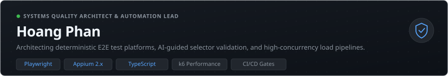
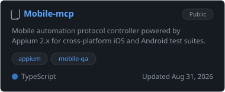

<div align="center">

<!-- Engineering Excellence Header Banner -->
[](https://github.com/hoangphan636)

<br/>

<!-- Restrained Typing Tagline -->
[;Deterministic+CI%2FCD+Quality+Gates+%26+Matrix+Sharding)](https://git.io/typing-svg)

<p align="center">
  <a href="https://linkedin.com/in/"></a>
  &nbsp;
  <a href="https://github.com/hoangphan636"></a>
  &nbsp;
  <a href="mailto:hoangphannhat10@gmail.com"></a>
  &nbsp;
  <a href="https://t.me/"></a>
</p>

</div>

---

### 🏛 Professional Overview

Senior QA Automation Engineer and Principal Quality Architect specializing in enterprise test infrastructure, deterministic end-to-end automation, and AI-guided test systems. With a background spanning web, mobile, distributed backend services, and high-concurrency performance engineering, I focus on building resilient test architectures that shift verification left, minimize maintenance overhead, and guarantee zero-defect release velocity.

<table>
  <tr>
    <td width="58%" valign="top">

```typescript
interface QualityArchitectProfile {
  name: "Hoang Phan";
  role: "Senior QA Automation Engineer • Principal Test Architect";
  location: "Ho Chi Minh City, Vietnam 🇻🇳";
  coreDisciplines: [
    "Enterprise E2E Web & Mobile Test Architecture",
    "High-Concurrency Performance & SLA Benchmarking",
    "AI-Augmented Self-Healing Locator Systems",
    "Deterministic CI/CD Matrix Quality Gates"
  ];
  methodology: "Shift-Left • Contract-Driven • Zero-Flakiness";
  availability: "Available for Senior / Lead / Principal QA roles";
}
```

> *"Program testing can be used to show the presence of bugs, but never to show their absence!"*  
> — **Edsger W. Dijkstra**

</td>
<td width="42%" align="center" valign="middle">


</td>
</tr>
</table>

---

### 📦 Featured Engineering Projects
*Curated flagship architectures solving critical challenges in test automation, selector stability, and cross-platform verification.*

<table>
  <tr>
    <td width="33.3%" valign="top">
      <a href="https://github.com/hoangphan636/playwright-agent-mcp">
        
      </a>
    </td>
    <td width="33.3%" valign="top">
      <a href="https://github.com/hoangphan636/Extension-QA">
        
      </a>
    </td>
    <td width="33.3%" valign="top">
      <a href="https://github.com/hoangphan636/Mobile-mcp">
        
      </a>
    </td>
  </tr>
</table>

#### 1. [playwright-agent-mcp](https://github.com/hoangphan636/playwright-agent-mcp) — Model Context Protocol Test Automation Server
- **Problem**: Modern single-page web applications suffer from frequent DOM restructuring and dynamic client-side hydration, causing high locator fragility, false-positive test failures, and continuous selector maintenance in automated E2E suites.
- **Technical Approach**: Built an autonomous server implementing the open Model Context Protocol (MCP) standard to interface LLM reasoning engines with Playwright browser instances. Implements real-time accessibility-tree traversal, dynamic selector resolution, and heuristic locator self-healing algorithms during live test execution.
- **Primary Technologies**: `TypeScript`, `Playwright`, `Model Context Protocol (MCP)`, `Chrome DevTools Protocol (CDP)`, `Node.js`
- **Verified Outcome**: Enables agentic browser automation workflows to dynamically interact with complex web applications without brittle static XPath or CSS selector dependencies.

#### 2. [Extension-QA](https://github.com/hoangphan636/Extension-QA) — DevTools Selector Generation & Validation Extension
- **Problem**: Test engineers spend significant manual time inspecting deeply nested DOM elements, formulating unique test locators, and checking their resilience against dynamic attribute changes across release cycles.
- **Technical Approach**: Developed a lightweight Chrome DevTools extension (Manifest v3) that evaluates active DOM hierarchies in real time. Generates deterministic, accessible locators prioritized by ARIA roles, `data-testid` semantics, and text constraints, followed by instant syntax evaluation against active Playwright and Cypress engines.
- **Primary Technologies**: `TypeScript`, `JavaScript`, `Chrome Extension API (Manifest v3)`, `DevTools Protocol`
- **Verified Outcome**: Accelerates test authoring cycles by generating deterministic, test-ready locator hierarchies directly in the developer's active browser context.

#### 3. [Mobile-mcp](https://github.com/hoangphan636/Mobile-mcp) — Cross-Platform Mobile Test Protocol Controller
- **Problem**: Running mobile test suites across fragmented device ecosystems (Android and iOS) requires maintaining disjointed driver configs, manual session handshakes, and platform-specific gesture bindings.
- **Technical Approach**: Engineered a centralized protocol gateway connecting Appium 2.x drivers (`UIAutomator2` for Android, `XCUITest` for iOS) with standardized MCP endpoints. Provides normalized touch gesture abstraction, device state management, and accessibility tree parsing across both mobile operating systems.
- **Primary Technologies**: `TypeScript`, `Appium 2.x`, `UIAutomator2`, `XCUITest`, `Node.js`
- **Verified Outcome**: Standardizes mobile automation commands into a single protocol interface, eliminating redundant platform-specific wrapper code.

---

### 🛠 Technical Expertise

| Domain | Core Technologies & Frameworks | Architectural Standards & Practices |
|---|---|---|
| **Web Automation** | Playwright, Cypress, Selenium WebDriver | Page Object Model (POM), Screenplay Pattern, Shadow DOM & Iframe Handling, Self-Healing Locators |
| **Mobile Automation** | Appium 2.x, UIAutomator2 (Android), XCUITest (iOS) | Real Device & Cloud Device Grid Execution, Native Gesture Automation, Deep Link Testing |
| **API & Integration Testing** | REST Assured, Postman, Supertest, OpenAPI / Swagger | Contract Testing, Schema Validation, BDD with Cucumber / Gherkin, Idempotency Verification |
| **Performance Engineering** | k6, Apache JMeter, Artillery | Concurrency Bounds, Spike & Endurance Testing, p95/p99 Latency SLA Validation, InfluxDB & Grafana |
| **AI Testing & Architecture** | Model Context Protocol (MCP), LLM Agent Tooling | Automated Selector Healing, Semantic Assertion Validation, Visual Regression, Agentic Test Discovery |
| **CI/CD & Test Reporting** | GitHub Actions, GitLab CI, Azure Pipelines, Docker | Parallel Matrix Sharding, Flakiness Quarantine Gates, Deterministic PR Verification, Allure Tracing |

<br/>

<div align="center">
  
</div>

---

### 📐 Engineering Architecture

```mermaid
flowchart LR
    subgraph Plan["1. Test Planning & Spec"]
        direction TB
        REQ["Requirements & User Flows"]
        BDD["Cucumber / Gherkin Specs"]
        RULE["Rule-Agent Contract Assertions"]
    end

    subgraph Gen["2. Discovery & Generation"]
        direction TB
        EXT["Extension-QA (DOM Inspector)"]
        LOC["Deterministic Accessible Selectors"]
    end

    subgraph Exec["3. Parallel Test Execution"]
        direction TB
        PW["Playwright (Web E2E Matrix)"]
        APM["Appium 2.x (Mobile iOS / Android)"]
        API["REST Assured (API Integration)"]
        K6["k6 (Load & Concurrency Bounds)"]
        MCP["playwright-agent-mcp (Self-Healing)"]
    end

    subgraph Report["4. Reporting & Triage"]
        direction TB
        ALLURE["Allure Reports & Artifacts"]
        TRACE["Playwright Traces & Network Dumps"]
        METRICS["Grafana SLA & Flakiness Triage"]
    end

    subgraph Gate["5. CI/CD Quality Gate"]
        direction TB
        GHA["GitHub Actions Matrix Runners"]
        VERDICT{"Pass Threshold Met?"}
        DEPLOY["Release / Deployment Ready"]
        BLOCK["Quarantine / Block PR"]
    end

    Plan --> Gen
    Gen --> Exec
    Exec --> Report
    Report --> Gate
    VERDICT -- Yes --> DEPLOY
    VERDICT -- No --> BLOCK
```



<div align="center">

[](https://github.com/hoangphan636)

</div>

---

### 💡 Engineering Philosophy

1. **Deterministic Over Flaky**: A flaky test provides negative value by eroding trust in the pipeline. Every test must execute idempotently, control its own test data fixtures, and eliminate arbitrary `sleep()` statements in favor of explicit state and locator assertions.
2. **Shift-Left Quality Architecture**: Quality is an architectural discipline embedded throughout design and implementation, not a downstream filter. Validating contracts, schemas, and BDD specifications prior to merge prevents defects before they reach production.
3. **Performance as a Core Functional Requirement**: A system that is correct but exceeds latency tolerances is a failed system. Every critical transaction flow must have verified p95 and p99 latency thresholds under defined peak concurrency.
4. **Resilient Test Infrastructure**: Test suites must outlive routine UI refactorings. Leveraging accessible semantic selectors (`data-testid`, ARIA roles) and AI-guided locator self-healing ensures high test suite longevity and low maintenance overhead.

---

### 📊 GitHub Activity

<details>
<summary><b>Inspect Verified GitHub Profile Overview</b></summary>
<br/>

<div align="center">


<p><i>Note: The majority of active enterprise frameworks, client automation suites, and proprietary testbeds reside in private organizational repositories.</i></p>

</div>

</details>
